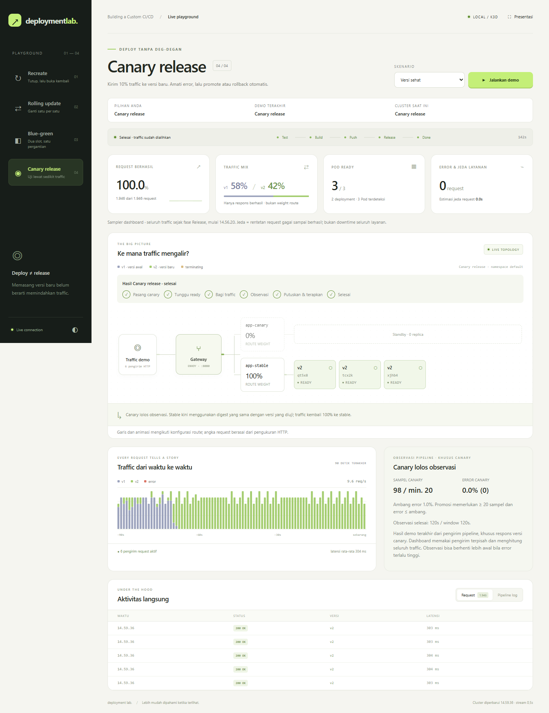

# Deploy Tanpa Deg-degan — Demo Empat Strategi Deployment

Repo ini pendamping sharing session **"Deploy Tanpa Deg-degan"** (seri
*Building a Custom CI/CD for Go*). Inti pesannya:

> **deploy** = memasang versi baru. **release** = memindahkan traffic ke versi itu.

Empat strategi deployment itu berbeda hanya di cara *release*-nya — dan di
repo ini kamu bisa **melihatnya langsung**: satu pipeline (`scripts/pipeline.sh`)
dengan tahap release yang bisa ditukar, ditonton lewat panel traffic live.
Semua jalan lokal di laptop: Docker + k3d + Envoy Gateway, tanpa cloud.

## Empat strategi, analogi tokonya

### Recreate — "Tutup toko, renovasi"

Pod lama dimatikan **semua dulu**, baru pod baru dibuat. Selama jeda itu
tidak ada yang melayani: di panel traffic kamu akan melihat baris merah
(ERR) berturut-turut, lalu durasi downtime-nya dicetak (`⛔ downtime 3.4s`).
Sederhana dan jujur — memang ada waktunya berdiam.

**Pakai kalau** v1 dan v2 tidak bisa jalan bersamaan (misal skema database
harus pindah sekali, bukan bertahap), dan downtime sebentar itu masih bisa
diterima.

### Rolling — "Ganti kasir satu-satu"

Pod baru naik satu per satu (`maxSurge: 1`, `maxUnavailable: 0`); setiap pod
lama baru berhenti setelah penggantinya siap. Di panel, v1 dan v2
**bercampur bertahap** — dan kalau graceful shutdown-nya benar: **0 error**.

**Pakai kalau** service-mu stateless dan tidak ada alasan khusus — ini
*default* yang wajar untuk mayoritas service.

### Blue-green — "Buka toko kembar"

Dua environment identik: `blue` yang aktif melayani 100%, `green` yang
menunggu. Versi baru dipasang di green, dites, lalu traffic dipindah
**seketika** hanya dengan mengubah weight di HTTPRoute — pod tidak
disentuh sama sekali. Mundur juga seketika (`make bluegreen-rollback`),
karena toko lamanya masih standing.

**Pakai kalau** kamu butuh rollback instan — misal rilis berisiko tinggi,
atau ekspektasi eksekutif "kalau rusak harus balik dalam hitungan detik".

### Canary — "Menu baru ke 10% tamu"

Versi baru dapet 10% traffic dulu (`app-canary`, weight di HTTPRoute).
Pipeline lalu **mengamati sendiri**: dia menembak gateway, menghitung
hanya respons yang `X-Version`-nya versi canary, dan memutuskan —
sehat? promote ke 100% dengan **digest yang sama** (tanpa build ulang).
Rusak? rollback otomatis, traffic balik ke versi lama, exit code ≠ 0.
Tanpa Prometheus, tanpa service mesh — traffic-lah buktinya, karena
health check (`/healthz`) memang tetap hijau walau user kena error.

**Pakai kalau** traffic besar dan metriknya bisa dipercaya — makin banyak
sampel, makin cepat versi rusak ketahuan.

## Prasyarat

| Alat | Cek versi | Catatan |
| --- | --- | --- |
| Docker | `docker version` | jalankan daemon-nya dulu |
| k3d | `k3d version` | K3s dalam Docker |
| kubectl | `kubectl version --client` | |
| Go 1.22+ | `go version` | untuk `go test` dan build lokal |
| envsubst | `envsubst --version` | bagian dari gettext; macOS: `brew install gettext` |

Script di repo ini bash, jalan di **Linux, macOS, atau Windows lewat WSL2**.

Di Windows, jalankan perintah dari distro Ubuntu WSL2 dan aktifkan distro
**Ubuntu** di Docker Desktop → Settings → Resources → WSL Integration.
Pastikan `docker info` dari Ubuntu menampilkan bagian Server tanpa error.
Tool Linux (`go`, `k3d`, `kubectl`, `make`, dan `envsubst`) harus tersedia
di dalam Ubuntu; instalasi tool Windows saja belum tentu cukup.
Folder repo ini dapat dibuka dari WSL dengan
`cd /mnt/d/sandbox/deploy-strategies-demo`.

Pipeline menjalankan test dengan `CGO_ENABLED=0`, sesuai build Docker.
Untuk test manual tanpa dependensi compiler/header C: `CGO_ENABLED=0 go test ./...`.

## Mulai cepat

### Dashboard interaktif

```bash
make cluster
make dashboard
```

Buka **http://localhost:9090** dari browser Windows. Biarkan terminal
`make dashboard` tetap berjalan. Tidak perlu Node.js, npm, atau `make watch`:
dashboard memakai Go stdlib dan membawa enam pengirim request sendiri.



- Pilih **Recreate**, **Rolling**, **Blue-green**, atau **Canary**, lalu klik
  **Jalankan demo**. Baseline v1 disiapkan otomatis oleh target Makefile.
- Diagram memperlihatkan Pod yang ready, mulai, atau terminating, beserta
  weight traffic HTTPRoute. Versi Pod dibaca lewat digest image lokal v1/v2;
  versi yang belum bisa dikenali ditampilkan sebagai `—`.
- Grafik dan metrik berasal dari request HTTP sungguhan. Animasi alur
  menggambarkan route yang dikonfigurasi, bukan tracing setiap request ke Pod.
- Pilih **Tanpa graceful** untuk pembanding rolling, atau **Versi rusak**
  untuk mengamati rollback canary otomatis. Blue-green menyediakan tombol
  **Rollback** ketika kedua slot siap.
- **Presentasi** menyembunyikan navigasi dan log untuk layar proyektor;
  tekan Escape untuk keluar. Tombol **◐** mengganti tema terang/gelap.

Dashboard hanya mendengarkan di loopback. Ia membaca context `k3d-demo`
dan menolak menjalankan pipeline jika context aktif kubectl berbeda.
Satu demo berjalan dalam satu waktu. Metrik dimulai ulang saat fase
**Release**, sehingga error saat reset baseline tidak dihitung sebagai
hasil release. Sebelum fase tersebut, metrik merupakan pengamatan live.
Data cluster diperbarui sekitar dua detik; stream browser setiap 0,5 detik.
Canary sehat memakai window observasi bawaan 120 detik.

Panel **Observasi pipeline** menampilkan sampel khusus canary, error rate,
ambang, dan waktu observasi yang dikirim oleh pipeline. Angka ini terpisah
dari sampler dashboard yang mengukur seluruh traffic. Rollback membedakan
**error melewati ambang** dan **bukti belum cukup**; sampel yang kurang tidak
berarti versi baru terbukti rusak. Traffic mix hanya menghitung respons
berhasil, sedangkan weight route menunjukkan konfigurasi pembagian traffic.

Bagian konteks membedakan pilihan strategi, demo berjalan/terakhir, dan
cluster saat ini. Memilih menu tidak menjalankan deployment. Urutan release
menunjukkan tahap memasang versi baru, readiness, pengalihan traffic,
observasi, dan hasil sesuai strategi. Estimasi jeda request adalah rentetan
respons gagal sampai ada respons berhasil, bukan ukuran downtime global.

Tes keputusan canary dan penerimaan event dashboard:

```bash
bash scripts/test-canary-decision.sh
CGO_ENABLED=0 go test ./cmd/dashboard
```

Konfigurasi opsional:

```bash
DASHBOARD_ADDR=127.0.0.1:9091 GATEWAY_URL=http://localhost:8081 make dashboard
```

### Demo lewat terminal

```bash
make cluster          # sekali: k3d + registry lokal + Envoy Gateway (idempoten)

# terminal 1 — panel traffic:
make watch

# terminal 2 — pilih demo:
make recreate         # downtime nyata, panel mencetak durasinya
make rolling          # v1/v2 bercampur, 0 error
make rolling-naive    # rolling TANPA graceful shutdown → 5xx/ERR terlihat
make bluegreen        # pindah 100% seketika
make bluegreen-rollback
make canary           # 10% → diamati → PROMOTED
make canary-bad       # versi rusak (FAIL_RATE=0.3) → ROLLBACK otomatis
```

Semua target demo mandiri (me-reset kondisi awal sendiri) dan memakai
`VERSION=v2` secara default supaya panel menampilkan v1 → v2. Ubah kalau
mau: `make rolling VERSION=v3`.

Kondisi awal suatu strategi juga bisa disiapkan manual: `make reset S=canary`.
Bersih-bersih: `make clean` (hapus cluster).

`make cluster` hanya menyiapkan infrastruktur. Endpoint
`http://localhost:8080/version` baru tersedia setelah `make reset S=rolling`
atau salah satu target demo berhasil; HTTP 404 sebelum itu normal.

Untuk menguji seluruh skenario pada cluster lokal:

```bash
bash scripts/verify-demo.sh
```

Pengujian ini me-reset workload demo, memeriksa promote/rollback dan panel
traffic, serta menyimpan log setiap skenario di direktori `/tmp` yang
dicetak saat mulai. Di akhir, aplikasi ditinggalkan pada rolling versi v2.

## Kenapa kodenya begini?

- **Graceful shutdown 4 langkah** (`main.go`) — urutannya disalin persis dari
  slide: (1) SIGTERM masuk, (2) `ready=false` sehingga `/readyz` → 503 dan
  pod keluar dari load balancer, (3) tunggu 5 detik supaya LB benar-benar
  mencabut pod, (4) `srv.Shutdown` menyelesaikan request yang sedang jalan
  (maksimal 20 detik). Hitungannya: 5 + 20 = 25 detik, harus di bawah
  `terminationGracePeriodSeconds: 30` — kalau lewat, Kubernetes mengirim
  SIGKILL. Bandingkan dengan `naive/main.go`: tanpa empat langkah itu,
  pod mati seketika dan request yang sedang berjalan **putus** — itu
  "celah" yang diperlihatkan `make rolling-naive` dan `make demo-shutdown`.
- **Liveness vs readiness** — `/healthz` menjawab "proses masih hidup?"
  (gagal → restart), `/readyz` menjawab "siap terima traffic?" (gagal →
  keluar dari LB, tanpa restart). Jangan cek database di liveness: kalau DB
  lambat, semua pod kamu di-restart bersamaan dan masalah makin besar.
- **`-ldflags` untuk versi** — `var version = "dev"` diisi saat build:
  `go build -ldflags "-X main.version=$(git rev-parse --short HEAD)"`.
  Setiap respons membawa header `X-Version`; tanpa ini kamu tidak tahu
  versi mana yang sedang menjawab saat canary berjalan.
- **Kenapa digest, bukan tag** — tag bisa digeser; digest menunjuk konten
  yang persis sama selamanya. Pipeline build **sekali**, lalu mempromosikan
  **digest yang sama** ke staging/production — yang diuji = yang dirilis.
  Di manifest, image selalu tertulis `...@sha256:<digest>`.

## Tanpa Kubernetes?

Cukup Docker: `make demo-shutdown` membandingkan dua container — versi
`naive` yang request-nya putus ketika di-`docker stop`, versus versi
graceful yang request-nya selesai `200 OK` setelah ±3 detik, lengkap
dengan log langkah shutdown 1–4. Graceful shutdown berlaku di mana pun:
Docker, Kubernetes, atau VPS polos.

## Struktur repo

```
main.go, main_test.go   aplikasi Go (stdlib saja) + test
naive/main.go           varian TANPA graceful shutdown (pembanding)
Dockerfile              multi-stage, binary statis, distroless, PID 1
scripts/setup-cluster.sh k3d + registry lokal + Envoy Gateway
scripts/pipeline.sh     entrypoint: test → build → push digest → release
scripts/reset.sh        kembalikan cluster ke kondisi awal strategi
scripts/watch.sh        panel traffic live
deploy/                 manifest + template (lihat deploy/README.md)
```

## Dokumen

- [`docs/demo-strategies.md`](docs/demo-strategies.md) — spesifikasi awal
  repo ini (requirement source-of-truth saat dibangun).
- [`docs/tech_spec.md`](docs/tech_spec.md) — tech spec hasil pipeline
  vibe-req → vibe-coding yang menghasilkan kode di repo ini.

## Troubleshooting singkat

- **Port 8080 dipakai** (`address already in use`) — matikan yang memakai
  (`lsof -i :8080`), atau bikin cluster dengan port lain:
  `HOST_PORT=8081 ./scripts/setup-cluster.sh` lalu `URL=http://localhost:8081/version ./scripts/watch.sh`.
- **`make cluster` berhenti di "menunggu Gateway ter-program"** — cek
  `kubectl get pods -n envoy-gateway-system`; biasanya image masih ditarik.
  Ulangi `make cluster` (idempoten) kalau koneksi tadi putus.
- **Panel semua ERR setelah reset** — tunggu beberapa detik; `reset.sh`
  menunggu pod v1 siap, tapi Envoy butuh sejenak mengenali endpoint baru.
- **`canary` berakhir ROLLBACK padahal versinya sehat** — sampel canary belum
  mencapai MIN_SAMPLES dalam window yang pendek; naikkan `OBSERVE_SECONDS` atau
  turunkan `MIN_SAMPLES` (semua knob ada di env, default di `scripts/pipeline.sh`).
- **Mau mulai dari nol** — `make clean && make cluster`.

## Kredit & lisensi

Materi sharing session "Deploy Tanpa Deg-degan" — lisensi MIT (lihat
[LICENSE](LICENSE)). Silakan pakai, pelajari, dan bagikan.
